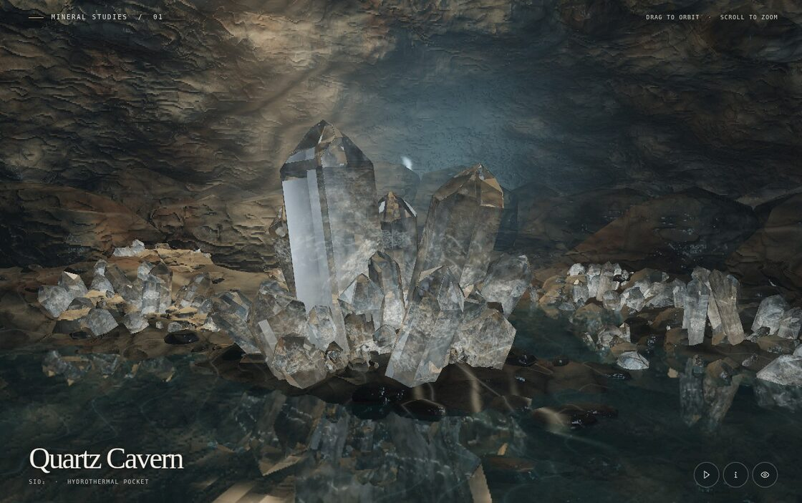

# Quartz Cavern

[Enter Quartz Cavern](https://isiliconx.github.io/quartzcavern/)

An interactive WebGL 2 study of an imagined hydrothermal quartz pocket. The rendering generates its geometry, materials, noise textures, reflections, water and lighting in the browser. No image, model, JavaScript framework or external runtime asset is needed.

## Controls

- Drag to orbit 360°; scroll to zoom. On touchscreens, drag with one finger and pinch with two.
- The camera resumes its glide after four seconds of inactivity.
- Arrow keys orbit, **+** / **−** zoom, **Space** pauses time and the automatic glide, **R** restores the opening camera angle, **I** opens the field notes, and **H** hides the interface.

To run it offline, download `index.html` and open it in a browser with WebGL 2 enabled.

## Geology references

The scene draws its six-sided prisms, unequal rhombohedral terminations, transverse growth marks, and optical index near 1.55 from the [Handbook of Mineralogy](https://www.handbookofmineralogy.org/pdfs/quartz.pdf). The cloudy matrix and intergrown crystal clusters draw on the [Arkansas Geological Survey](https://geology.arkansas.gov/docs/pdf/education/arkansas-quartz-crystals.pdf) and the [Smithsonian’s Berns Quartz](https://naturalhistory.si.edu/explore/collections/geogallery/10026927). The monumental cavern and accelerated pace are artistic reconstructions, not a depiction of the actual specimen or a geological timescale.

